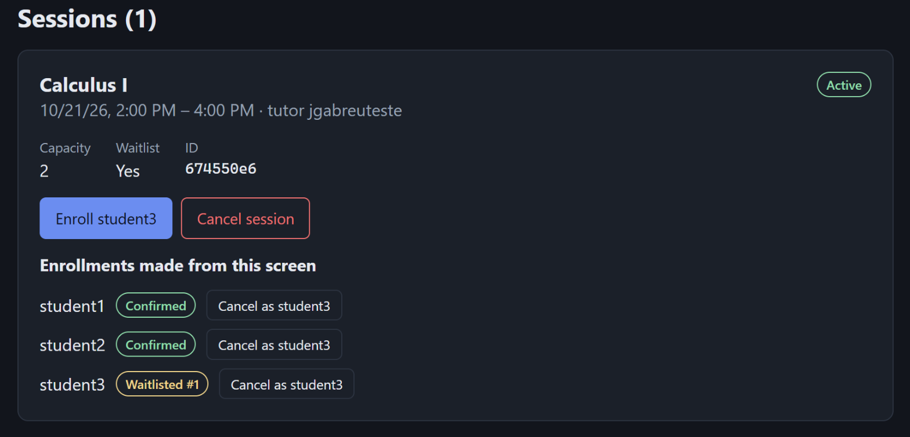
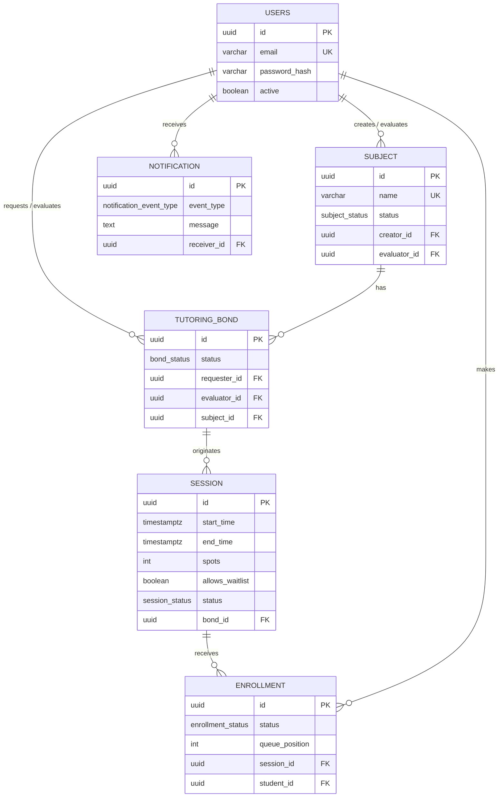
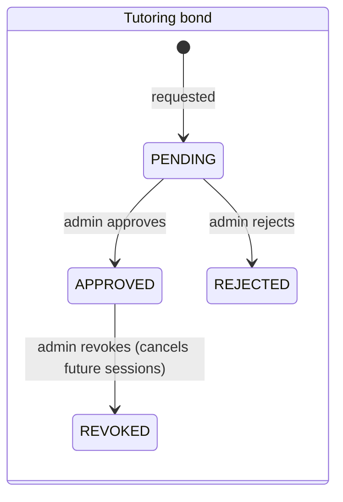
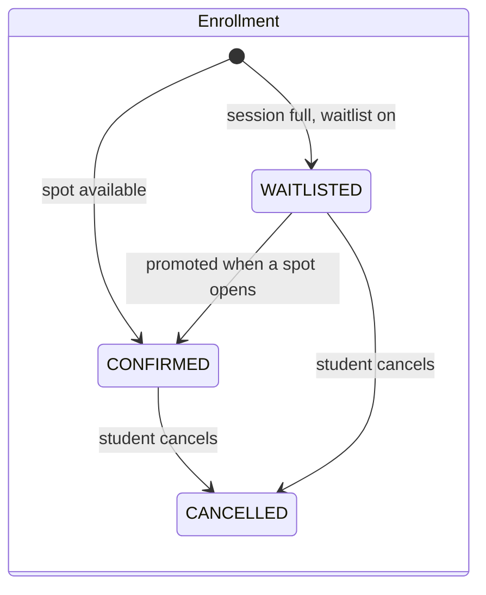

# Tutoring Management System

[](https://github.com/jg-abreu/tutoring-management-system/actions/workflows/ci.yml)


[](LICENSE)

A Spring Boot REST API and a React client for running academic tutoring programs: admins approve who can tutor which subject, tutors open sessions with limited spots, and students enroll — with an automatic waitlist that promotes the next student when a spot opens up.

<p align="center">
  
  <br>
  <sub>A session with a waitlist, as shown by the <a href="frontend/">demo client</a>.</sub>
</p>

**Live demo: [tutoring.joaoabreu.dev](https://tutoring.joaoabreu.dev)** — log in with any sample user (password `senha123`). The data resets to the sample set every day at 06:00 UTC. How it is hosted: [`deploy/README.md`](deploy/README.md).

Built as a portfolio project with a focus on **domain modeling**, **business rules enforced as state machines** and **context-based authorization**, with a PostgreSQL schema designed up front. A React client that demos every flow lives in [`frontend/`](frontend/).

## Contents

- [Why this project](#why-this-project)
- [Features](#features)
- [Tech stack](#tech-stack)
- [Quick start (Docker)](#quick-start-docker)
- [Domain model](#domain-model)
- [Design decisions](#design-decisions)
- [API](#api)
- [Testing](#testing)
- [Local development](#local-development)
- [Demo client](#demo-client)
- [Project structure](#project-structure)
- [Roadmap](#roadmap)

## Why this project

Study groups and tutoring programs at universities are usually run through spreadsheets and group chats: there is no real control over who is allowed to tutor a subject, how many students fit in a session, or what happens to enrolled students when a tutor drops out. This system turns that informal process into explicit, enforced rules.

## Features

- **JWT authentication** — users log in with email and password and get a token valid for 2 hours; every other route requires it, and the acting user always comes from the token, never from the request body.
- **Approval workflows** — anyone can suggest a subject or ask to tutor one; an admin approves or rejects each request.
- **Capacity and waitlist** — sessions have a fixed number of spots; once full, students join an optional waitlist with a queue position.
- **Automatic promotion** — when a confirmed student cancels, the first waitlisted student is promoted, the queue is renumbered without gaps and the promoted student is notified, all in a single transaction.
- **Cancellation cascade** — cancelling a session cancels its active enrollments and notifies each student; revoking a tutor's bond does the same for all of their future sessions.
- **Roles and context-based permissions** — users are `ADMIN` or `USER`, and only admins approve, reject or revoke. There is no fixed "tutor" role: everything else depends on the user's relationship to the record (for example, only the admin who approved a bond can cancel its sessions, and a tutor cannot enroll in their own session).
- **Predictable errors** — domain exceptions map to `400`, `403`, `404` and `409`, and unexpected errors return a generic `500` without leaking internals.

## Tech stack

| Layer | Technologies |
|---|---|
| Backend | Java 21, Spring Boot 4.1 (Web MVC, Data JPA, Validation, Security), Hibernate, Lombok, Auth0 java-jwt |
| Database | PostgreSQL 17 (UUID keys, native enums, partial unique index, check constraints) |
| Testing | JUnit 5, Mockito, Spring MockMvc |
| Infrastructure | Docker Compose, GitHub Actions |

## Quick start (Docker)

The only requirement is [Docker](https://www.docker.com/products/docker-desktop/).

```bash
git clone https://github.com/jg-abreu/tutoring-management-system.git
cd tutoring-management-system
docker compose up --build
```

Compose starts PostgreSQL with the schema and sample data, the API and the client:

| Service | Address | Notes |
|---|---|---|
| Client | http://localhost:3000 | log in with any sample user below |
| API | http://localhost:8080 | use an HTTP client; there are no `GET` endpoints yet, so the browser shows a 404 |
| PostgreSQL | `localhost:5433` | database, user and password: `tutoring` |

Log in with `POST /auth/login` and send the returned token as `Authorization: Bearer <token>` on every other request. The sample data includes an admin, a tutor with an approved bond for *Calculus I*, and three students, all with the password **`senha123`**:

| User | Email | Role | Acts as | UUID |
|---|---|---|---|---|
| admin | `admin@tutoring.dev` | `ADMIN` | Admin | `2c53ba13-53cc-4c79-a4f2-31cfbcceb898` |
| jgabreuteste | `tutor@tutoring.dev` | `USER` | Calculus I tutor | `899b90d5-673e-4137-abd2-1606d73f9b0e` |
| student1 | `student1@tutoring.dev` | `USER` | Student | `451c540f-a05f-4ead-a6d3-89528391d8ad` |
| student2 | `student2@tutoring.dev` | `USER` | Student | `fb0e9fd2-7181-495c-922b-dd4c7e5baf2c` |
| student3 | `student3@tutoring.dev` | `USER` | Student | `b5578fc3-17cd-4277-aec8-407227991e1f` |

To see the waitlist in action, run [`http/auth.http`](http/auth.http) in IntelliJ's HTTP Client to log everyone in, then [`http/session.http`](http/session.http): the tutor creates a session with 1 spot and the waitlist enabled, the three students enroll and the first one cancels. To click through the same flows in a browser, open the client at http://localhost:3000.

Data persists across `docker compose down`; use `docker compose down -v` to reset to the sample data.

## Domain model



Every status change goes through a service method that checks the current state first, so invalid transitions return `409 Conflict`:





The schema was designed and documented before any Java code — see the [schema notes](docs/database_schema_reference.md), the full [SQL schema](docker/postgres/init/01-schema.sql) and the original [design diagrams](docs/diagrams) (ER, class and the 8 business flows).

## Design decisions

- **Only the admin role is stored.** A user is `ADMIN` or `USER`; being a tutor *of a subject* is derived from holding an approved bond for it, so the same person can tutor one subject and be a student in another. The admin check runs in the services, before the record is loaded, so a regular user gets `403` and never learns whether a subject or bond exists.
- **Sessions belong to the bond, not the user.** This makes the revocation cascade a single query on `bond_id` instead of cross-referencing users and subjects.
- **Nothing is physically deleted.** Cancelling, rejecting and revoking are status changes, so history is preserved.
- **The database enforces what it can.** UUID keys, native enums, `CHECK` constraints (`spots >= 1`, `end_time > start_time`) and a partial unique index that blocks two live bonds for the same tutor and subject.
- **Business logic lives in the services.** Enrollment status has no database default because confirming or waitlisting depends on counting taken spots; the service decides inside a transaction.
- **Stateless authentication.** The API issues a signed JWT (HMAC256, 2 hours, secret from the `JWT_SECRET` environment variable) instead of keeping server sessions, so CSRF protection is off: no cookie is sent automatically. A filter validates the token and loads the user on every request, so a deactivated user loses access immediately. There are no refresh tokens yet.

## API

| Method | Route | Action | Allowed for |
|---|---|---|---|
| `POST` | `/auth/login` | Log in, returns `{ token, tokenType, expiresAt, role }` | anyone (the only public route) |
| `GET` | `/subjects` · `/subjects/{id}` | List subjects by name (optional `?status=`) or read one | any user |
| `POST` | `/subjects` | Suggest a subject | any user |
| `PATCH` | `/subjects/{id}/approve` · `/reject` | Approve or reject a subject | `ADMIN` |
| `GET` | `/tutoring-bonds` · `/tutoring-bonds/{id}` | List bonds, newest first (optional `?status=`), or read one | `ADMIN` sees all; others only the bonds they requested |
| `POST` | `/tutoring-bonds` | Request a tutoring bond | any user, on an approved subject |
| `PATCH` | `/tutoring-bonds/{id}/approve` · `/reject` · `/revoke` | Evaluate or revoke a bond | `ADMIN` |
| `GET` | `/sessions` · `/sessions/{id}` | List sessions by start time (optional `?status=`) or read one | any user |
| `GET` | `/sessions/{id}/enrollments` | A session's enrollments: confirmed, then the waitlist by position, then the rest | any user |
| `POST` | `/sessions` | Create a session | the bond's requester or evaluator |
| `PATCH` | `/sessions/{id}/cancel` | Cancel a session | the bond's evaluator |
| `POST` | `/sessions/{id}/enrollments` | Enroll in a session | any user, on an active session |
| `GET` | `/enrollments` | The logged-in user's own enrollments, newest first | any user |
| `PATCH` | `/enrollments/{id}/cancel` | Cancel an enrollment | the enrolled student |

Every route except `/auth/login` requires `Authorization: Bearer <token>`, and the acting user is the token's user; request bodies carry no user ids.


Each endpoint returns a response record, never a JPA entity: subjects, bonds, sessions and enrollments keep their nesting (an enrollment carries its session, which carries its bond and subject), and every user inside a response is only `{ id, email }`, with no role, password data or account flags.

Responses use **201** on create, **200** on update, **400** for invalid input, **401** for a missing, invalid or expired token or a failed login, **403** when the user isn't allowed, **404** for missing records and **409** for conflicts with the current state. Runnable request collections live in [`http/`](http).

## Testing

```bash
./mvnw test
```

The suite has **182 tests**: unit tests for every service (JUnit 5 + Mockito, named `should...When...`) covering success paths, permission and role checks and invalid transitions; MockMvc tests for login, token validation (missing, expired, tampered, inactive user) for every endpoint taking the user from the token and for the fields each response exposes; plus a Spring context test that validates the JPA mappings against the real schema. Tests were written right after each service rather than at the end.

[GitHub Actions](.github/workflows/ci.yml) runs the suite against a PostgreSQL service on every push and pull request.

## Local development

Requires Java 21 and Docker. With no environment variables, the API connects to the PostgreSQL from Docker Compose (`localhost:5433`, user and password `tutoring`, schema and sample data loaded on the first start) and signs tokens with a development-only key:

```bash
docker compose up -d db       # PostgreSQL only
./mvnw spring-boot:run        # http://localhost:8080
./mvnw test                   # the context test uses the same database
```

To reset the sample data, `docker compose down -v` and start it again.

### Production profile

Servers run with `SPRING_PROFILES_ACTIVE=prod`. In that profile every value comes from the environment, with no defaults, so a missing variable stops the API at startup instead of falling back to the development values:

| Variable | Example |
|---|---|
| `DB_URL` | `jdbc:postgresql://<host>:5432/<database>` (add `?sslmode=require` when the database requires TLS) |
| `DB_USERNAME`, `DB_PASSWORD` | the database user |
| `JWT_SECRET` | a random string of 32+ characters |

## Demo client

[`frontend/`](frontend/) is a React + TypeScript client that covers every flow in the browser. `docker compose up --build` serves it at http://localhost:3000; for development, with the API running, run `npm install && npm run dev` in `frontend/` (http://localhost:5173, already allowed by CORS). Its [usage guide](frontend/docs/USAGE.md) walks through each flow step by step.

The client logs in with the sample users (password `senha123`) and sends the token on every request.

The client moved to its own repository (`tutoring-management`) during v2.0 and came back to `frontend/` with its history after the v2.0 release, so the API and the client change together in one PR.

## Project structure

```
├── src/main/java/.../tutoringmanagementsystem
│   ├── controller/      REST endpoints
│   ├── service/         business rules and state transitions
│   ├── model/           JPA entities and status enums
│   ├── repository/      Spring Data repositories (derived queries)
│   ├── dto/             validated request bodies and the response records
│   ├── exception/       domain exceptions + GlobalExceptionHandler
│   └── config/          security, JWT filter and CORS
├── src/test/            service unit tests and MockMvc controller tests
├── deploy/             live demo: production compose, nginx site, daily reset and how to rebuild it
├── docker/postgres/     schema and seed loaded by Docker Compose
├── docs/                schema notes, design diagrams, specs
├── frontend/            React client (see its README)
└── http/                IntelliJ HTTP Client request collections
```

## Roadmap

- [x] **v1.0** — domain model, all business flows, error handling and unit tests
- [x] **v1.1** — React frontend, input validation and error handling fixes
- [x] **v1.2** — Docker Compose setup, CI and English translation
- [x] **v2.0** — a public demo next to [joaoabreu.dev](https://joaoabreu.dev): authentication, roles, read endpoints and the client's new look
  - ✅ Frontend moved to its own repository (back in `frontend/` after the release)
  - ✅ Authentication with JWT, with the acting user taken from the token instead of the request body
  - ✅ User roles (`ADMIN`, `USER`), so admin-only actions are actually restricted
  - ✅ The React client logs in, shows admin actions only to admins and shares the portfolio's visual identity
  - ✅ Response DTOs instead of serialized JPA entities
  - ✅ `GET` endpoints for subjects, bonds, sessions and enrollments
  - ✅ Cancelling a session or revoking a bond also cancels its enrollments and notifies the students
  - ✅ Prevent tutors from enrolling in their own sessions
  - ✅ Separate development and test database
  - ✅ Deploy with a public demo link ([tutoring.joaoabreu.dev](https://tutoring.joaoabreu.dev))
- [ ] **v2.1**: admins cancelling enrollments, normalized subject names, database locking for the last spot, field-level validation errors, Testcontainers and OpenAPI

See the [changelog](CHANGELOG.md) for what changed in each release.

## License

Released under the [MIT License](LICENSE).

## Author

**João Abreu** — back-end developer and Computer Science student in Rio de Janeiro, Brazil.

[GitHub](https://github.com/jg-abreu) · [LinkedIn](https://www.linkedin.com/in/jo%C3%A3o-abreuuu) · jgabreudev@gmail.com
