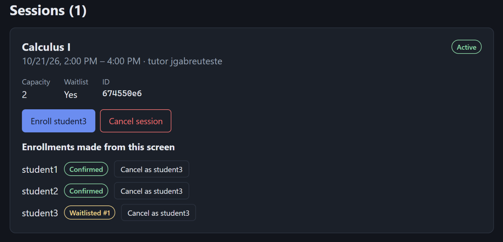
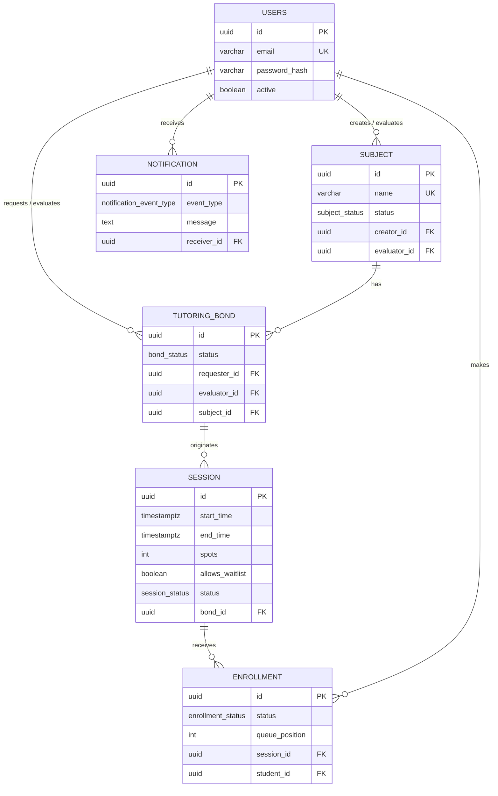
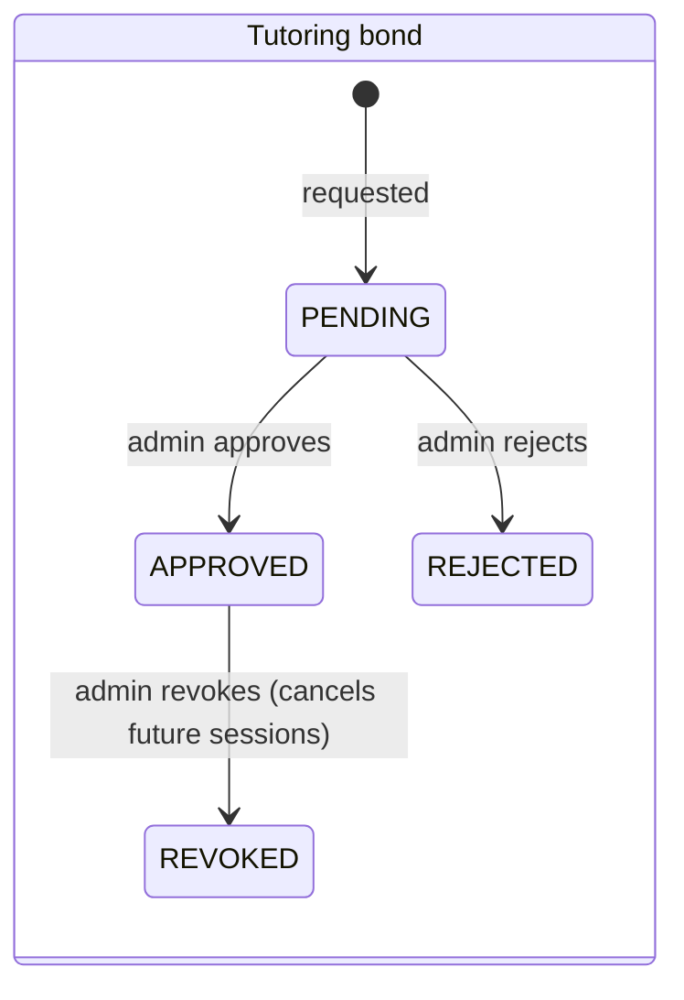
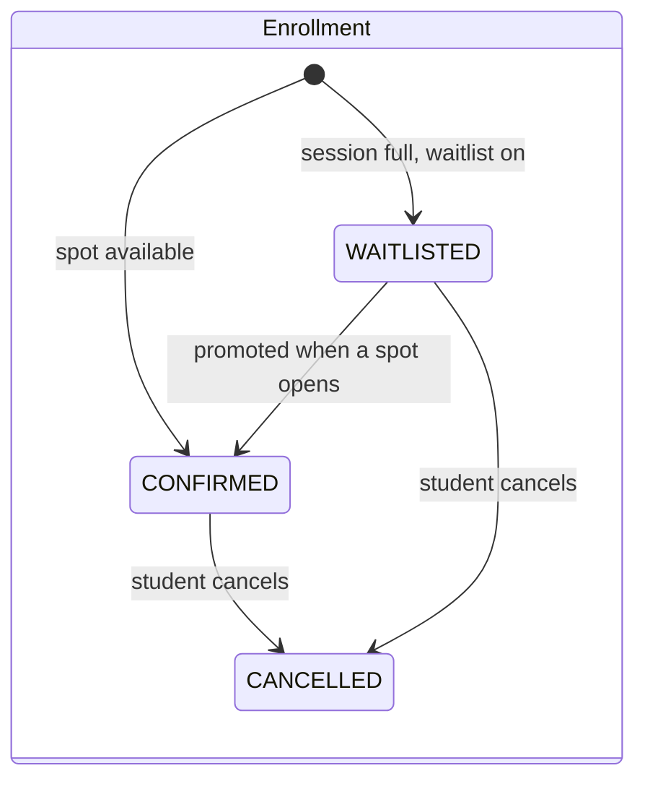

# Tutoring Management System

[](https://github.com/jg-abreu/tutoring-management-system/actions/workflows/ci.yml)


[](LICENSE)

A full-stack system for running academic tutoring programs: admins approve who can tutor which subject, tutors open sessions with limited spots, and students enroll — with an automatic waitlist that promotes the next student when a spot opens up.

<p align="center">
  
</p>

Built as a portfolio project with a focus on **domain modeling**, **business rules enforced as state machines** and **context-based authorization**, backed by a Spring Boot REST API, a PostgreSQL schema designed up front and a React frontend.

## Contents

- [Why this project](#why-this-project)
- [Features](#features)
- [Tech stack](#tech-stack)
- [Quick start (Docker)](#quick-start-docker)
- [Domain model](#domain-model)
- [Design decisions](#design-decisions)
- [API](#api)
- [Testing](#testing)
- [Local development](#local-development)
- [Project structure](#project-structure)
- [Roadmap](#roadmap)

## Why this project

Study groups and tutoring programs at universities are usually run through spreadsheets and group chats: there is no real control over who is allowed to tutor a subject, how many students fit in a session, or what happens to enrolled students when a tutor drops out. This system turns that informal process into explicit, enforced rules.

## Features

- **Approval workflows** — anyone can suggest a subject or ask to tutor one; an admin approves or rejects each request.
- **Capacity and waitlist** — sessions have a fixed number of spots; once full, students join an optional waitlist with a queue position.
- **Automatic promotion** — when a confirmed student cancels, the first waitlisted student is promoted, the queue is renumbered without gaps and the promoted student is notified, all in a single transaction.
- **Revocation cascade** — revoking a tutor's bond cancels all of their future sessions.
- **Context-based permissions** — there is no fixed "tutor" role; what a user can do depends on their relationship to the record (for example, only the admin who approved a bond can cancel its sessions).
- **Predictable errors** — domain exceptions map to `400`, `403`, `404` and `409`, and unexpected errors return a generic `500` without leaking internals.

## Tech stack

| Layer | Technologies |
|---|---|
| Backend | Java 21, Spring Boot 4.1 (Web MVC, Data JPA, Validation), Hibernate, Lombok |
| Database | PostgreSQL 17 (UUID keys, native enums, partial unique index, check constraints) |
| Frontend | React 19, TypeScript, Vite, oxlint — no UI or state libraries |
| Testing | JUnit 5, Mockito |
| Infrastructure | Docker Compose, nginx, GitHub Actions |

## Quick start (Docker)

The only requirement is [Docker](https://www.docker.com/products/docker-desktop/).

```bash
git clone https://github.com/jg-abreu/tutoring-management-system.git
cd tutoring-management-system
docker compose up --build
```

Then open **http://localhost:3000**. Compose starts PostgreSQL with the schema and sample data, the API and the frontend:

| Service | Address | Notes |
|---|---|---|
| Frontend | http://localhost:3000 | main entry point |
| API | http://localhost:8080 | use an HTTP client; there are no `GET` endpoints yet, so the browser shows a 404 |
| PostgreSQL | `localhost:5433` | database, user and password: `tutoring` |

There is no login yet, so the frontend has an **"Acting as"** switcher to choose who performs each action. The sample data includes an admin, a tutor with an approved bond for *Calculus I*, and three students:

| User | Email | Role | UUID |
|---|---|---|---|
| admin | `admin@tutoring.dev` | Admin | `2c53ba13-53cc-4c79-a4f2-31cfbcceb898` |
| jgabreuteste | `tutor@tutoring.dev` | Calculus I tutor | `899b90d5-673e-4137-abd2-1606d73f9b0e` |
| student1 | `student1@tutoring.dev` | Student | `451c540f-a05f-4ead-a6d3-89528391d8ad` |
| student2 | `student2@tutoring.dev` | Student | `fb0e9fd2-7181-495c-922b-dd4c7e5baf2c` |
| student3 | `student3@tutoring.dev` | Student | `b5578fc3-17cd-4277-aec8-407227991e1f` |

To see the waitlist in action, act as the tutor, create a session with 1 spot and the waitlist enabled, then enroll the three students and cancel the first one. The [usage guide](docs/USAGE.md) walks through every flow step by step.

Data persists across `docker compose down`; use `docker compose down -v` to reset to the sample data.

## Domain model



Every status change goes through a service method that checks the current state first, so invalid transitions return `409 Conflict`:





The schema was designed and documented before any Java code — see the [schema notes](docs/database_schema_reference.md), the full [SQL schema](docker/postgres/init/01-schema.sql) and the original [design diagrams](docs/diagrams) (ER, class and the 8 business flows).

## Design decisions

- **Roles are derived, not stored.** A user is a tutor *of a subject* if they hold an approved bond for it. The same person can tutor one subject and be a student in another.
- **Sessions belong to the bond, not the user.** This makes the revocation cascade a single query on `bond_id` instead of cross-referencing users and subjects.
- **Nothing is physically deleted.** Cancelling, rejecting and revoking are status changes, so history is preserved.
- **The database enforces what it can.** UUID keys, native enums, `CHECK` constraints (`spots >= 1`, `end_time > start_time`) and a partial unique index that blocks two live bonds for the same tutor and subject.
- **Business logic lives in the services.** Enrollment status has no database default because confirming or waitlisting depends on counting taken spots; the service decides inside a transaction.
- **Known trade-off:** the acting user's UUID is sent in the request body until authentication lands in v2.0.

## API

| Method | Route | Action | Allowed for |
|---|---|---|---|
| `POST` | `/subjects` | Suggest a subject | any user |
| `PATCH` | `/subjects/{id}/approve` · `/reject` | Approve or reject a subject | admin\* |
| `POST` | `/tutoring-bonds` | Request a tutoring bond | any user, on an approved subject |
| `PATCH` | `/tutoring-bonds/{id}/approve` · `/reject` · `/revoke` | Evaluate or revoke a bond | admin\* |
| `POST` | `/sessions` | Create a session | the bond's requester or evaluator |
| `PATCH` | `/sessions/{id}/cancel` | Cancel a session | the bond's evaluator |
| `POST` | `/sessions/{id}/enrollments` | Enroll in a session | any user, on an active session |
| `PATCH` | `/enrollments/{id}/cancel` | Cancel an enrollment | the enrolled student |

\* User roles arrive in v2.0; for now these endpoints accept any existing user.

Responses use **201** on create, **200** on update, **400** for invalid input, **403** when the user isn't allowed, **404** for missing records and **409** for conflicts with the current state. Runnable request collections live in [`http/`](http).

## Testing

```bash
./mvnw test
```

The suite has **61 tests**: unit tests for every service (JUnit 5 + Mockito, named `should...When...`) covering success paths, permission checks and invalid transitions, plus a Spring context test that validates the JPA mappings against the real schema. Tests were written right after each service rather than at the end.

[GitHub Actions](.github/workflows/ci.yml) runs the backend suite against a PostgreSQL service and lints and builds the frontend on every push and pull request.

## Local development

**Backend** — requires Java 21 and a PostgreSQL database with [the schema](docker/postgres/init/01-schema.sql) (Hibernate runs with `ddl-auto=validate` and doesn't create tables). Set the connection through environment variables and start the API:

```bash
export DB_HOST=localhost:5432 DB_NAME=tutoring DB_USERNAME=... DB_PASSWORD=...
./mvnw spring-boot:run        # http://localhost:8080
```

The default configuration connects over SSL, as used with [Neon](https://neon.com) in day-to-day development; for a local database without SSL, set `SPRING_DATASOURCE_URL=jdbc:postgresql://localhost:5432/tutoring` instead.

**Frontend** — requires Node.js 20+ and the API running:

```bash
cd frontend
npm install
npm run dev                   # http://localhost:5173
```

See the [frontend README](frontend/README.md) for its structure and commands.

## Project structure

```
├── src/main/java/.../tutoringmanagementsystem
│   ├── controller/      REST endpoints
│   ├── service/         business rules and state transitions
│   ├── model/           JPA entities and status enums
│   ├── repository/      Spring Data repositories (derived queries)
│   ├── dto/             validated request bodies
│   ├── exception/       domain exceptions + GlobalExceptionHandler
│   └── config/          CORS
├── src/test/            service unit tests
├── frontend/            React + TypeScript client
├── docker/postgres/     schema and seed loaded by Docker Compose
├── docs/                schema notes, usage guide, design diagrams
└── http/                IntelliJ HTTP Client request collections
```

## Roadmap

- [x] **v1.0** — domain model, all business flows, error handling and unit tests
- [x] **v1.1** — React frontend, input validation and error handling fixes
- [x] **v1.2** — Docker Compose setup, CI and English translation
- [ ] **v2.0** (in progress, starting with authentication)
  - Authentication, with the acting user taken from the token instead of the request body
  - User roles, so admin-only actions are actually restricted
  - `GET` endpoints for subjects, bonds, sessions and enrollments
  - Response DTOs instead of serialized JPA entities
  - Cancelling a session or revoking a bond also cancels its enrollments and notifies the students
  - Prevent tutors from enrolling in their own sessions
  - Normalize subject names (case and accents) before the duplicate check
  - Database locking so two students can't take the last spot at the same time

See the [changelog](CHANGELOG.md) for what changed in each release.

## License

Released under the [MIT License](LICENSE).

## Author

**João Abreu** — back-end developer and Computer Science student in Rio de Janeiro, Brazil.

[GitHub](https://github.com/jg-abreu) · [LinkedIn](https://www.linkedin.com/in/jo%C3%A3o-abreuuu) · jgabreudev@gmail.com
