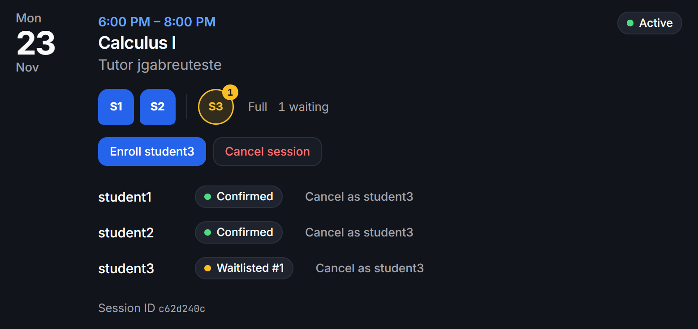

# Tutoring Management

[](https://github.com/jg-abreu/tutoring-management/actions/workflows/ci.yml)


Web client for the [Tutoring Management API](https://github.com/jg-abreu/tutoring-management-api). It covers the whole flow in the browser: suggesting and approving subjects, requesting and evaluating tutoring bonds, creating and cancelling sessions, enrolling students and cancelling enrollments (with a waitlist).

<p align="center">
  
</p>

The business rules, the database and the tests live in the API repository; this client exists to demo them.

## Stack

- **React 19** + **TypeScript**
- **Vite** (dev server and build)
- **oxlint** (linting)
- No UI, state or HTTP libraries: native `fetch`, Context API, plain CSS with variables and automatic dark mode

## Running

Both options need the API running on `http://localhost:8080`. The quickest way is Docker, in the API repository:

```bash
git clone https://github.com/jg-abreu/tutoring-management-api.git
cd tutoring-management-api
docker compose up --build
```

### With Node.js (development)

Prerequisite: Node.js 20+.

```bash
npm install
npm run dev
```

Open `http://localhost:5173`. The API already allows this origin via CORS.

To point to a different API, create a `.env.local` file with:

```
VITE_API_URL=http://other-host:8080
```

### With Docker

```bash
docker compose up --build
```

Open `http://localhost:3000`. nginx serves the build and forwards `/api/` to the API, so the browser sees a single origin. The API address comes from the `API_URL` environment variable (default `http://host.docker.internal:8080`, the API on your machine); if another program uses port 8080 on your machine, point it elsewhere, for example `API_URL=http://other-host:8080 docker compose up --build`.

### Commands

| Command | What it does |
|---|---|
| `npm run dev` | dev server with hot reload |
| `npm run build` | type check + production build into `dist/` |
| `npm run lint` | lint with oxlint |
| `npm run preview` | serves the production build locally |

## Structure

```
src/
├── api/          central HTTP client and one function per API endpoint
├── components/   reusable components (status badge, messages, user switcher)
├── config/       temporary test data (users and database records)
├── context/      shared state (current user, known records)
├── features/     one folder per screen: subjects, bonds, sessions
├── hooks/        useLocalStorage, useApiAction
└── lib/          date and time zone formatting
```

The [usage guide](docs/USAGE.md) walks through every flow step by step, from an empty catalog to a session with a waitlist.

## Known limitations

- **No login yet:** the "Acting as" switcher picks the user who performs each action; the user list is hardcoded in `src/config/testData.ts` and matches the API's sample data. Login arrives with the API's authentication.
- **The API has no `GET` endpoints yet:** the lists only show what was created or changed from the screen itself (stored in `localStorage`). Changes the server makes to other records, such as waitlist promotion, don't show up until there is a way to query them.
- **No user roles:** the approve/reject buttons show up for every user; the API decides.

## History

This client started in the `frontend/` folder of the API repository and moved here with its commit history.
